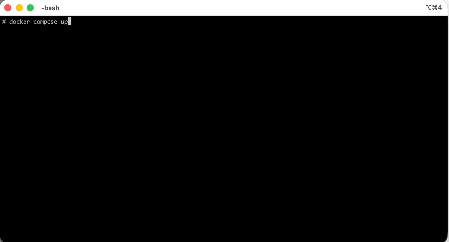
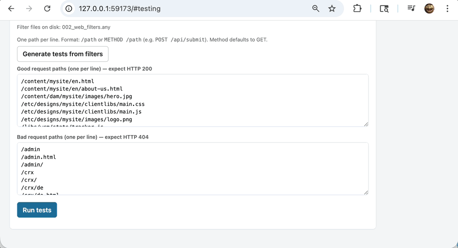

# AEM Dispatcher Filter & ModSecurity Sandbox

A local sandbox for writing and testing [Adobe Experience Manager](https://business.adobe.com/products/experience-manager/adobe-experience-manager.html) **Dispatcher filter rules** and the **ModSecurity (WAF) rules** in front of them. Everything runs in one container on your machine. No AEM licence, AEM instance or cloud account is needed.

---

## Contents

- [What is this?](#what-is-this)
- [Before you start](#before-you-start)
- [Quick start (5 minutes)](#quick-start-5-minutes)
- [Walkthrough: test dispatcher filters](#walkthrough-test-dispatcher-filters)
- [Walkthrough: test ModSecurity rules](#walkthrough-test-modsecurity-rules)
- [Writing test requests](#writing-test-requests)
- [Control panel tabs](#control-panel-tabs)
- [Folders on your machine](#folders-on-your-machine)
- [Logs](#logs)
- [Stopping, updating and cleaning up](#stopping-updating-and-cleaning-up)
- [Troubleshooting](#troubleshooting)
- [Other ways to run it (Podman, `docker run`)](#other-ways-to-run-it)
- [Reference](#reference)

---

## What is this?

AEM sites are almost always fronted by Apache httpd with two layers of protection:

1. **ModSecurity**, a web application firewall (WAF). It inspects each request (URL, query string, headers, body) and blocks attacks, usually with **403 Forbidden**.
2. The **AEM Dispatcher** module. Its **filter rules** decide which requests may reach AEM at all. Rejected requests get **404 Not Found**.

Getting either layer wrong is a security or outage risk, and testing them normally needs a full AEM environment. This sandbox gives you:

- A real **Apache + `mod_dispatcher.so`**, so filters behave exactly as in production
- **ModSecurity 2.9** on the same vhost, loaded with **your** rule set (none are built in)
- A **fake AEM publish** backend that answers 200 to anything the dispatcher lets through
- A **browser control panel** to edit rules, run test requests, and see which filter or ModSecurity rule allowed or blocked each one





---

## Before you start

You need three things:

| What | How to check | Where to get it |
|---|---|---|
| **Docker Desktop** (or Podman) running | `docker --version` prints a version, and `docker ps` doesn't error | [docker.com/products/docker-desktop](https://www.docker.com/products/docker-desktop/) · Podman: see [docs/podman.md](docs/podman.md) |
| **Git** | `git --version` | [git-scm.com/downloads](https://git-scm.com/downloads) (macOS offers to install it on first use) |
| **Free ports 80 and 59173** on your machine | nothing else (another web server, another copy of this sandbox) is using them | see [Troubleshooting](#troubleshooting) to use other ports |

All commands below are typed into a terminal: Terminal.app on Mac, PowerShell or WSL on Windows, any shell on Linux.

> **Apple Silicon Macs (M1–M4):** nothing special to do. The container runs as x86_64 (`linux/amd64`) on purpose, because that's what the Adobe dispatcher module needs on Rocky Linux 8. Docker Desktop handles this automatically.

---

## Quick start (5 minutes)

**1. Get the code**

```bash
git clone https://github.com/calebpryor/aem-dispatcher-filter-testing.git
cd aem-dispatcher-filter-testing
```

Run every command below from inside this `aem-dispatcher-filter-testing` folder.

**2. (Optional) Add your ModSecurity rules**

To test ModSecurity, copy your rule files (`*.conf`, plus any `*.data` files they reference) into the `modsecurity/` folder now. You can also do this later while the container is running. Skip this step if you only want to test dispatcher filters.

```bash
cp /path/to/your/rules/*.conf /path/to/your/rules/*.data modsecurity/
```

Everything you put in `modsecurity/` is git-ignored, so private rules are never committed.

**3. Build and start the container**

```bash
docker compose up --build
```

The first build takes a few minutes (it installs Apache and ModSecurity inside the image). Later starts take seconds. Leave this terminal open: it shows the live container output. Startup is done when you see a line like `Control panel listening on 0.0.0.0:59173`.

**4. Open the control panel**

Go to **[http://127.0.0.1:59173](http://127.0.0.1:59173)** in your browser.

The first time you open it, the panel **downloads the dispatcher module automatically**. Adobe's `mod_dispatcher.so` isn't bundled in the image; it comes from Adobe's public download site. This takes up to a minute. If a **"Install dispatcher module"** window appears instead, pick the newest version and click **Download module & start**.

**5. Check that it's running**

Open the **Sandbox Controls** tab. *Module* should say **installed**, and `control`, `dispatcher` and `renderer` should all show **RUNNING**. The dispatcher is now live at **[http://localhost](http://localhost)**.

You're ready. Follow one of the walkthroughs below.

---

## Walkthrough: test dispatcher filters

1. Open the **Testing** tab and set **Test scope** to **Filters only**. ModSecurity is switched off, so only the filters decide.
2. Open the **Filters** tab.
   - **Default policy:** leave it on **Deny all**, like production. Everything is rejected unless an `allow` rule matches.
   - Paste your filter rules (`/0001 { /type "allow" … }` blocks) into **Edit filter rules** and click **Save & Restart**. The rules are saved to `filters/002_web_filters.any` on your machine.
   - Or generate rules: paste request lines such as `GET /content/site/en.html` into **Generate rules from requests**.
3. Back on the **Testing** tab:
   - **Good request paths** should be allowed (expect **200**).
   - **Bad request paths** should be rejected (expect **404**).
   - Click **Generate tests from filters** to fill both lists from your rules, or type your own.
4. Click **Run tests**. Green rows passed, red rows failed. The **Filter match** column shows which rule made the decision. Click a path to open it in your browser.
5. Use **Export JSON / CSV** to share results, or **Save tests** to keep the lists in `tests/`.

---

## Walkthrough: test ModSecurity rules

1. Make sure your rule files are in `modsecurity/` (see [Quick start step 2](#quick-start-5-minutes)). Files copied in while the container runs are picked up automatically within a few seconds.
2. Open the **Testing** tab and set **Test scope** to **ModSecurity only**. Your dispatcher filters are replaced by an "allow everything" stub, so only ModSecurity decides.
3. Open the **ModSecurity** tab.
   - **Rule files** lists every `.conf` file. A rule and its `_logonly` twin (`name.conf` + `name_logonly.conf`) count as **one** rule with a choice of **Block**, **Log only** or **Off**. Only one variant is ever loaded, because both use the same rule IDs. Other files are **On** or **Off**.
   - Change modes, then click **Apply & restart**.
   - Problems are shown in red: duplicate rule IDs, or missing `.data` files (an empty placeholder is created for those).
   - **Active rules** lists every loaded rule with its ID. You'll use these IDs in tests.
   - **Edit rule & data files** lets you change a rule or a `.data` list, such as allowlisted IPs or author hostnames.
4. Every change (mode switch, edit in the panel, or file changed on disk) is checked with `httpd -t` **before** it goes live. A broken rule is rejected with the error message, and the dispatcher keeps running on the last good config.
5. On the **Testing** tab:
   - **ModSecurity blocked requests** should be blocked (expect **403**).
   - **Allowed requests** must get through (expect **200**).
   - Run the tests. The **ModSecurity** column shows each rule ID that matched: **red** means it blocked the request, **amber** means it only logged.
6. To test **both layers together** as in production, switch **Test scope** to **Filters + ModSecurity**.

> The **Engine** setting on the ModSecurity tab is a global switch. **On** enforces rules, **DetectionOnly** logs matches but blocks nothing, and **Off** disables ModSecurity. Raise **Debug log level** to see rule-by-rule tracing in `logs/modsec_debug.log`.

---

## Writing test requests

Each line in a test list is one request. The simplest form is just a path:

```
/content/site/en.html
POST /content/site/en/form.html
```

You can add **curl-style options** after the path. This matters for ModSecurity rules that look at headers, bodies or hostnames:

```
/content/site/en.html?debug=true
/etc/packages -H 'Host: author.example.com' --expect '!403'
POST /some/endpoint -d 'param=value' -d 'other=1' -e https://attacker.example/
/system/console --rule 1234 --expect '!403'
curl -s -X POST -H 'Content-Type: text/xml' --data '<x/>' 'http://localhost/soap/endpoint'
```

| Option | Meaning |
|---|---|
| `-H 'Name: value'` | Add a request header (repeatable). `-H 'Host: …'` tests rules that treat some hostnames differently. |
| `-d 'body'` | Request body (repeatable, joined with `&`). Makes the request a POST with a form content type unless you set `-X` / `Content-Type`. |
| `-A` · `-e` · `-b` · `-X` | User-Agent · Referer · Cookie · HTTP method |
| `--expect 406` | Expect this status instead of the list's default |
| `--expect '!403'` | Pass on anything **except** 403 ("must not be blocked") |
| `--rule <id>` | Fail unless ModSecurity rule `<id>` fired. Use it to test **Log only** rules, which don't change the status code. |

Notes:

- You can paste **whole `curl` commands**. The URL's hostname is sent as the `Host` header, but the request always goes to the local sandbox, never the real site.
- Paths are sent exactly as typed: encoded characters (`%2f`), `..` and `;` are kept, so you can test bypass tricks. Spaces are encoded automatically.
- Test requests are sent from **inside** the container, from `127.0.0.1`. Requests you make from your own browser come from Docker's network address, so rules that allowlist client IPs may treat them differently.

---

## Control panel tabs

| Tab | What it's for |
|---|---|
| **1. Guide** | Step-by-step guide inside the panel |
| **2. Sandbox Controls** | Service status, restart Apache, switch the dispatcher module version |
| **3. Filters** | Default policy (deny all / allow all), active filter rules, rule generator, filter editor |
| **4. ModSecurity** | Engine mode, debug level, Block / Log only / Off per rule, rule & data file editor |
| **5. Testing** | Test scope, test lists, run tests, export results |
| **6. Logs** | Live views of every log file |

Keyboard shortcut: `Ctrl+Shift+1` … `Ctrl+Shift+6` jumps between tabs.

---

## Folders on your machine

These folders are shared with the container, so changes made on either side show up on the other.

| Folder | What goes there |
|---|---|
| `filters/` | Dispatcher filter files (`*.any`). Loaded in name order, so number them (`001_…`, `002_…`). The panel edits `002_web_filters.any` by default. See [filters/README.md](filters/README.md). |
| `modsecurity/` | Your ModSecurity rule set: `*.conf` and `*.data` files, sub-folders allowed. **Git-ignored** apart from its README. See [modsecurity/README.md](modsecurity/README.md). |
| `tests/` | Saved test lists (`*_test_paths.json`). `default_test_paths.json` loads automatically. |
| `logs/` | Log files written by the container (git-ignored). |

Panel settings (default policy, test scope, rule modes, module version) are kept in `filters/.prefs.json`, which is git-ignored, and survive container restarts.

---

## Logs

All logs are in `logs/` and can be viewed live on the **Logs** tab.

| File | What it shows |
|---|---|
| `dispatcher.log` | Full dispatcher trace, including every filter rule evaluated per request |
| `filter-test.log` | Only the filter decisions from `dispatcher.log` |
| `error_log` | Apache errors and one `ModSecurity: …` line per rule match |
| `access_log` | Every request Apache received |
| `modsec_audit.log` | Full request details for requests ModSecurity blocked (403) |
| `modsec_debug.log` | Rule-by-rule ModSecurity tracing (set the level on the ModSecurity tab) |
| `renderer_access_log`, `renderer_error_log` | The fake AEM backend |

For a combined live stream of everything the container prints: `docker compose logs -f`

---

## Stopping, updating and cleaning up

| Task | Command |
|---|---|
| Stop (if it's running in your terminal) | Press `Ctrl+C` |
| Stop (from another terminal) | `docker compose down` |
| Start again later | `docker compose up` (add `-d` to run in the background) |
| Get the latest version of this project | `git pull`, then `docker compose up --build` |
| Remove your private rules from disk | delete everything in `modsecurity/` except `README.md` |

Your filters, rules, tests and settings live in the folders above, so they survive stops, restarts and rebuilds.

---

## Troubleshooting

**`docker: command not found` / `Cannot connect to the Docker daemon`**
Docker Desktop isn't installed or isn't running. Start Docker Desktop, wait until it says it's running, and try again.

**`port is already allocated` / `address already in use` for port 80**
Something else on your machine uses port 80 (often another web server or another copy of this sandbox; `docker ps` shows running containers). Stop it, or change `"80:80"` in `docker-compose.yml` to `"8080:80"` and use `http://localhost:8080`.

**Control panel doesn't open (port 59173)**
Check the container is running: `docker compose ps`. If the port is taken, run `cp .env.example .env`, set `CONTROL_PORT` in `.env` to a free port (for example `49821`), run `docker compose up` again, and open `http://127.0.0.1:49821`.

**Port 80 doesn't respond, but the control panel works**
The dispatcher module isn't installed yet. Open the control panel. It installs automatically, or shows a window where you can pick a version and click **Download module & start**. You can also install or switch versions on the **Sandbox Controls** tab.

**Module download fails**
The container needs internet access to download the module from Adobe. Check that your network or VPN allows it, then retry from **Sandbox Controls**.

**My ModSecurity change didn't take effect**
It probably failed the `httpd -t` check. The ModSecurity tab shows the error for panel changes. For files edited on disk, run `docker compose logs` and look for `httpd config test FAILED`. The last good config stays loaded until you fix the error.

**ModSecurity tab says a rule ID is duplicated**
Two loaded files use the same rule ID. Usually that's a rule and its `_logonly` twin copied under names that don't pair up, or two copies of the same rule set. Turn one off or remove the extra copy.

**Every test returns 404**
With **Filters only** or **Filters + ModSecurity** and the default policy **Deny all**, everything is rejected until you add `allow` filter rules. Add filters, switch the Default policy to **Allow all**, or set the test scope to **ModSecurity only**.

**Requests from my browser get 403 but the panel tests pass**
Your browser's requests reach the container from Docker's network address, not `127.0.0.1`. Rules that allowlist client IPs block them. Turn such rules off or add the address to their `.data` list.

**`GLIBC` errors / the module won't load**
Keep `platform: linux/amd64` in `docker-compose.yml`. The arm64 dispatcher build needs a newer system library than Rocky Linux 8 has.

---

## Other ways to run it

- **Podman** (instead of Docker): [docs/podman.md](docs/podman.md)
- **Plain `docker run`** without Compose, or building the image by hand: [docs/docker.md](docs/docker.md)

---

## Reference

- [Dispatcher filter configuration (Adobe docs)](https://experienceleague.adobe.com/en/docs/experience-manager-dispatcher/using/configuring/dispatcher-configuration#configuring-access-to-content-filter)
- [ModSecurity 2.x reference manual](https://github.com/owasp-modsecurity/ModSecurity/wiki/Reference-Manual-%28v2.x%29)
- [`filters/README.md`](filters/README.md): filter file conventions
- [`modsecurity/README.md`](modsecurity/README.md): rule set layout, load order, modes and testing notes
- [`dispatcher/README.md`](dispatcher/README.md): supplying your own `mod_dispatcher.so`
